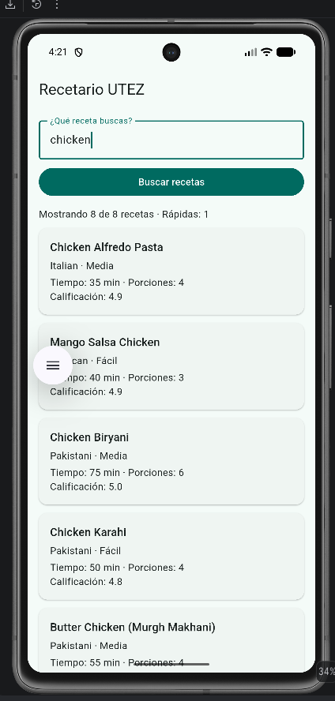
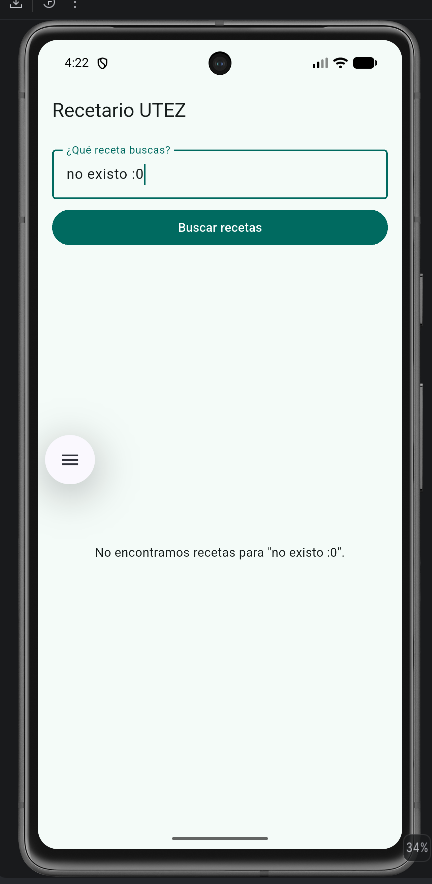
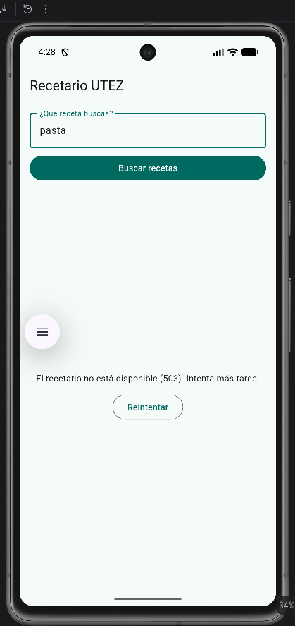
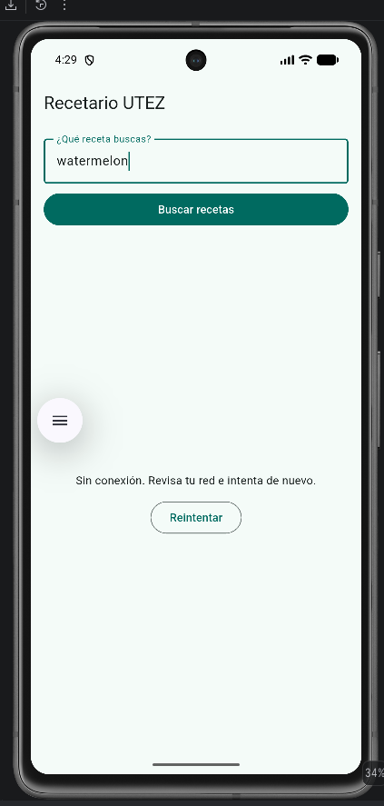
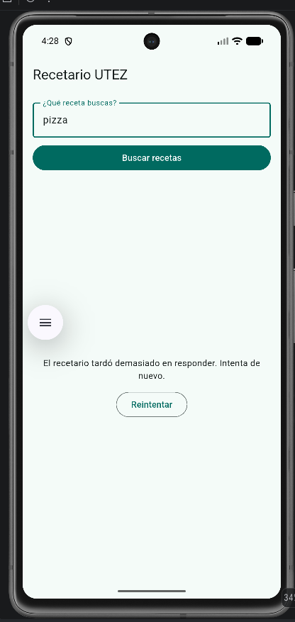

# Evidencias — Recetario UTEZ

**Nombre:** Erick
**Matrícula:** _(tu matrícula)_
**Fecha:** _(fecha en que tomaste las capturas)_
**Dispositivo donde se probó:** _(emulador Android, teléfono, Chrome, Windows…)_

## 1. Del JSON a Dart

| JSON | Campo Dart | Tipo | Regla (obligatorio, tolerado, valor por defecto) |
|---|---|---|---|
| `id` | `id` | `int` | Obligatorio. Si falta o no es `int` → `FormatException`. |
| `name` | `nombre` | `String` | Obligatorio. Si falta o no es texto → `FormatException`. |
| `cuisine` | `cocina` | `String` | Obligatorio. Si falta o no es texto → `FormatException`. |
| `difficulty` | `dificultad` | `Dificultad` | Tolerado. `Easy`/`Medium`/`Hard` → `facil`/`media`/`dificil`; cualquier otro valor, `null` o número → `desconocida` ("Sin dato"). Nunca lanza error. |
| `prepTimeMinutes` | `minutosPreparacion` | `int` | Obligatorio. Si falta o no es `int` → `FormatException`. |
| `cookTimeMinutes` | `minutosCoccion` | `int` | Obligatorio. Si falta o no es `int` → `FormatException`. |
| `servings` | `porciones` | `int` | Obligatorio. Si falta o no es `int` (p. ej. `"4"`) → `FormatException`. |
| `rating` | `calificacion` | `double` | Obligatorio. Se acepta cualquier `num` (entero `5` o decimal `4.6`) y se guarda con `.toDouble()`. |
| `tags` | `etiquetas` | `List<String>` | Opcional: si falta → `[]`. Si viene pero no es lista o algún elemento no es texto → `FormatException`. |
| `ingredients` | `ingredientes` | `List<String>` | Opcional: si falta → `[]`. Si viene pero no es lista o algún elemento no es texto → `FormatException`. |
| `recipes` | `PaginaRecetas.recetas` | `List<Receta>` | Obligatorio; cada elemento debe ser objeto (si no → `FormatException`). Una lista vacía es válida. |
| `total` | `PaginaRecetas.total` | `int` | Obligatorio. Si falta → `FormatException`. |

Los demás campos (`image`, `instructions`, `caloriesPerServing`, `userId`, `reviewCount`, `mealType`, `skip`, `limit`…) se ignoran.

## 2. Escenarios probados con el servicio real

| Escenario | Cómo lo provoqué | Qué vio la persona | Línea de la bitácora | Captura | Prueba del kit que lo cubre |
|---|---|---|---|---|---|
| Éxito | Busqué `chicken` y toqué **Buscar recetas**. | _(p. ej. "Mostrando 8 de 8 recetas · Rápidas: N" y las tarjetas)_ | `← 200 GET /recipes/search (___ ms)` |  | `etapa3`: "200 → PaginaRecetas"; `etapa5`: "texto + botón → indicador y botón apagado → tarjetas" |
| Vacío | Busqué `no existo :0`. | _(p. ej. `No encontramos recetas para "no existo :0".`)_ | `← 200 GET /recipes/search (___ ms)` |  | `etapa3`: "200 sin resultados → página vacía"; `etapa5`: "vacío con texto dice qué se buscó…" |
| Error del servidor | Cambio temporal A en `main.dart` (ruta `/http/503`). | _(p. ej. "El recetario no está disponible (503). Intenta más tarde." + Reintentar)_ | `✗ badResponse 503 GET /http/503 (___ ms)` |  | `etapa3`: "503 → ErrorDelServidor(503)"; `etapa4`: "FallaRed → Fallidas con el mensaje de mensajePara" |
| Sin red | _(modo avión / Wi-Fi apagado, o cambio temporal C)_ | _(p. ej. "Sin conexión. Revisa tu red e intenta de nuevo." + Reintentar)_ | `✗ connectionError GET /recipes/search (___ ms)` _(copia la que te salga)_ |  | `etapa3`: "sin red → SinConexion"; `etapa5`: "error → mensaje y Reintentar repite la misma búsqueda" |
| Tiempo agotado | Cambio temporal B (`delay: 5000` y timeouts de 2 s). | _(p. ej. "El recetario tardó demasiado en responder. Intenta de nuevo." + Reintentar)_ | `✗ receiveTimeout GET /recipes/search (___ ms)` |  | `etapa3`: "connectTimeout → TiempoAgotado" y "receiveTimeout → TiempoAgotado" |

## 3. Preguntas de reflexión

1. **¿En qué se diferencian el escenario "Error del servidor" y "Sin red" desde el punto de vista de HTTP?**
   En el error del servidor **sí hubo conversación HTTP**: la petición llegó a DummyJSON y este respondió con un código de estado (503) y un cuerpo; Dio lo reporta como `badResponse` con `response.statusCode`. En "Sin red" **nunca hubo respuesta HTTP**: falló antes (DNS, socket, TLS), no existe código de estado y Dio lo reporta como `connectionError`/`unknown`. Por eso uno se traduce a `ErrorDelServidor(503)` ("intenta más tarde") y el otro a `SinConexion` ("revisa tu red").

2. **¿Por qué "Vacío" no es un error?**
   Porque el servidor respondió `200 OK` con un JSON válido (`"recipes": []`, `"total": 0`): la petición se hizo bien y la respuesta es correcta, simplemente no hay coincidencias. Es un resultado legítimo del dominio, así que se modela como un estado propio (`RecetasVacias`) con un mensaje que dice qué se buscó, no como una `FallaRed` ni con botón de reintentar.

3. **La búsqueda de la persona viaja en la query. ¿Por qué tu bitácora no la escribe?**
   Porque lo que escribe una persona puede ser información privada o sensible, y la bitácora se guarda o se comparte (consola, reportes, servicios de logs). Para diagnosticar basta con método, ruta, código y tiempo. Por eso el interceptor usa `options.path` (sin query) en lugar de `options.uri`, y nunca toca `queryParameters`, encabezados ni el cuerpo.

4. **Si DummyJSON cambiara `rating` por `score`, ¿qué archivos tendrías que modificar y por qué solo esos?**
   Solo `lib/datos/recetas_json.dart` (cambiar la llave `'rating'` por `'score'` en `recetaDesdeJson`) y, si se quiere, los datos de prueba/documentación que reflejan el JSON. El dominio (`Receta.calificacion`), el ViewModel y las vistas no cambian, porque la traducción JSON → Dart está aislada en la capa de datos: el resto de la app solo conoce `Receta`, no el formato del servidor.
